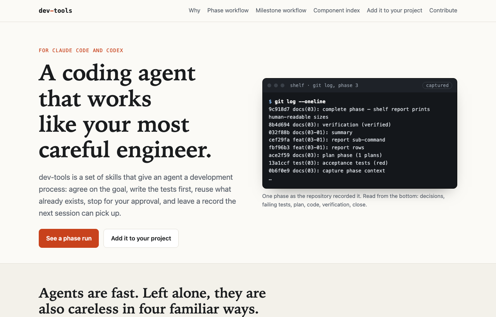

# dev-tools

A development process for coding agents (Claude Code and Codex), kept in one place and
copied into each project that uses it.

**Documentation: <https://vasiloglou.github.io/dev-tools/>**



Status: prototype.

dev-tools is developed with dev-tools. Since 2026-11-21, work on this repository runs
under the milestone workflow it ships: see [Developed with itself](#developed-with-itself).

## Why

A coding agent writes code faster than anyone can read it. What is left to settle is
whether the code does what was asked, whether it rebuilt something that already existed,
and whether the next session can carry on from it. These skills make an agent agree on
the goal, write the tests first, reuse what exists, stop for your approval and leave a
record, and each of those is held by a check that can refuse, not by a sentence in a
prompt. The reasoning is on the site:
[Why it exists](https://vasiloglou.github.io/dev-tools/why.html).

## What it gives an agent

- **Phase workflow.** One roadmap phase at a time, in seven steps: Orient, Discuss (with
  a timeboxed prototype), Specify (acceptance tests, locked before code is written),
  Plan, Implement, Verify, Close. You approve at four of them. Two advisory checks
  compare the plans with the agreed tests and with each other (two plans meant to run side
  by side that name the same file), and the change with the plans.
- **Milestone workflow.** A reviewed plan, a spec you approve before any code, an
  independent review of each change, and numbered records that are never edited. A
  review helper writes the brief, runs the reviewer in the other tool (Codex from Claude
  Code, Claude Code from Codex) and keeps a findings ledger; a repaired file counts as
  unreviewed until a later round reads it.
- **Component index.** A searchable map of what the code already does, so existing code
  is reused instead of written again. The agent can build it for a codebase that has
  none, check it against every change, and review it from the top: repair the index and
  list the code changes it would suggest.
- **Project rules (optional, a trial).** A project states which areas of its code may
  use which, and other rules about its components, and every change is checked against
  them: only what the change added is reported. The same file can hold rules about the
  plans of a phase, judged before the plans are approved, and rules about single files,
  such as a private file used only inside its component. Each rule can carry examples it
  must fail and pass on (`rules_check.py test`), and with GND 0.3.1 the check
  also names a rule that matched nothing, a misspelt value, and what an edit of the rules
  hides, and `rules_check.py suggest` reads off the code which areas it already keeps
  apart and where it almost does. The index is exported as plain facts;
  the rules are judged by [GND](https://github.com/vasiloglou/gnd-public), which the
  project installs separately. GND is what makes a rule a line of data and not another
  hand-written check, and what tells a new finding from one that was already there:
  [Project rules and GND](https://vasiloglou.github.io/dev-tools/rules.html).

- **Hand-offs.** Unfinished work moves to another assistant, another account or another
  machine with what the session knew. `dev-handoff` writes a note for the branch (goal,
  what was verified, next step, decisions, your instructions, jobs and data outside git),
  a check says what would be lost (uncommitted files, unpushed commits, empty sections, a
  pasted key), and the files git ignores are copied to the other checkout. `dev-takeover`
  lists the hand-offs, checks the machine, verifies the note against the code and
  continues from its next step. The note informs; it approves nothing.

A project picks the workflow that fits it. Both use the component index, and the hand-off
skills work with either.

## How a project takes it

This repository is the canonical source. A project lists what it wants in a
`.devtools.toml` file, and the sync command copies those skills and scripts into the
project, where they are committed. The project takes no dependency on this repository.

```bash
python3 path/to/dev-tools/devtools/sync.py apply --project .
```

```bash
python3 path/to/dev-tools/devtools/sync.py check --project .
```

- `apply` copies the files and records each one in `.devtools-receipt.json`. It writes
  nothing unless every file can be written: a file the project edited by hand needs
  `--force`, and an existing file it does not manage yet needs `--adopt`.
- `check` compares the managed files with the receipt. It needs only the project.

Rules that belong to one project go in a file that project owns,
`references/project.md` beside the synced skill. The sync never touches it.

A project that already has its own copies of these skills moves to the shared ones with
the `adopt-devtools` skill (`skills/adopt-devtools/SKILL.md`, read from this checkout). Two
commands that write nothing do the looking:

```bash
python3 path/to/dev-tools/devtools/sync.py survey --project .
```

```bash
python3 path/to/dev-tools/devtools/sync.py compare --project .
```

- `survey` finds the project's copies of what is shipped here, including copies under
  another name, and `survey --toml` prints a starter `.devtools.toml` that keeps the
  project's paths.
- `compare` lists every file an apply would replace and how many of the project's lines
  are in no shipped file; `compare <path>` prints those lines. The skill decides what
  happens to each one before anything is overwritten.

A project that was planned with GSD moves to the phase workflow with the `move-from-gsd`
skill (`skills/move-from-gsd/SKILL.md`, read from this checkout). Both keep the plan in
`.planning/` and name phase folders the same way, so the folder of a finished phase stays
as it is; the roadmap, the requirements and the state are rewritten in the format the
phase tool reads, and GSD's own files are kept in `.planning/archive/gsd/`:

```bash
python3 path/to/dev-tools/devtools/from_gsd.py survey --project .
```

```bash
python3 path/to/dev-tools/devtools/from_gsd.py convert --project . --dry-run
```

- `survey` writes nothing. It lists the plans GSD keeps (the root plan and any
  workstreams), every phase with the status it will get, the requirements, the decisions,
  GSD's install inside the project, and what needs a decision first: which plan to move,
  a phase GSD did not finish, phases it had put off, a roadmap that restarted its numbers.
- `convert` writes the planning files and a record of every choice it made. Phase numbers
  are kept, and a requirement keeps its id with `REQ-` in front (`AUTH-01` becomes
  `REQ-AUTH-01`). A phase GSD did not finish is taken up again from its discussion, with
  GSD's plans for it kept as input in a `gsd/` folder inside the phase folder. Phases GSD
  had paused or left in its backlog are listed, not queued.

A GSD project whose milestones are each a stretch of work of their own (several
workstreams, phase numbers that start again) can take the milestone workflow instead:
nothing is converted, GSD's files stay as history, and the guide's last section has the
steps.

Only GSD has a converter. `sync.py survey` names a plan kept by another planning tool (Spec Kit,
OpenSpec, Kiro, BMAD, Task Master, Agent OS, or a `.planning/` folder in another format), and
`skills/adopt-devtools/SKILL.md`, "Coming from another planning tool", says how it is carried
by hand.

See `examples/phase-project.devtools.toml` for a complete project file
(`examples/milestone-project.devtools.toml` for the milestone workflow), and
`examples/components-check.yml` for a GitHub Actions job that checks the index on every
pull request (`examples/rules-check.yml` does the same for a project's own rules). A new project on
the phase workflow follows the first sync with
`python3 .claude/skills/process-phase/scripts/phase_tool.py setup`. The milestone workflow has no
setup command: it needs the planning folder with a `PROJECT.md`, which the project's own
scaffold step writes (its `references/project.md` names it).

The sync command, the GSD converter and the component index need Python 3.11 or newer; the phase state tool,
the review helper and the hand-off script run on 3.9.

## Or install it as a Claude Code plugin

The same skills ship as two Claude Code plugins, one per workflow, from the marketplace in
this repository. A project installs one: both have a skill called `process-phase`.

```bash
claude plugin marketplace add vasiloglou/dev-tools
```

```bash
claude plugin install dvt-phase@dvt
```

`dvt-phase` holds the phase workflow, its helper agents and the component index;
`dvt-milestone` holds the milestone workflow, `review-pr` and the component index. Both
hold `handle-issue`, `dev-handoff` and `dev-takeover`. Their
skills and agents are named after the plugin: `/dvt-phase:process-phase`,
`dvt-phase:phase-implementer`, `/dvt-milestone:review-pr`. `--scope project` records the
plugin in the project's `.claude/settings.json`, so every teammate gets it.

A plugin is one copy that every project shares, so what a synced copy keeps beside the skill
lives in the project instead:

| Synced copy | Plugin |
|---|---|
| `references/project.md` beside the skill | `.devtools/project.md` |
| `scripts/<script>.settings.json` beside the script | `.devtools/<script>.settings.json` (same keys; none means the defaults) |
| `python3 .claude/skills/<skill>/scripts/<script>.py` | `python3 ${CLAUDE_PLUGIN_ROOT}/skills/<skill>/scripts/<script>.py`, run from the project root |
| `{{devtools:planning_dir}}` filled from `.devtools.toml` | `.planning` in the milestone skills' text |

Codex installs the same plugins from the same marketplace:

```bash
codex plugin marketplace add vasiloglou/dev-tools
```

```bash
codex plugin add dvt-milestone@dvt
```

Codex leaves `${CLAUDE_PLUGIN_ROOT}` empty, so each skill says where the plugin's folder is:
two levels above its `SKILL.md`. `codex plugin add` has no scope option: it installs the
plugin for the user, in every project.

Pick the sync when the project changes the skills themselves, keeps a planning folder other
than `.planning` on the milestone workflow, runs the component index in CI (CI needs a copy
of `components_index.py` in the project), or wants Codex to take the skills for that project
only. The phase workflow's `pytest --phase` plugin is in
the plugin at `skills/process-phase/pytest/phase_selection.py`; copy it to the project's
`conftest.py`, as the sync would.

`plugins/` is generated from `skills/` and `agents/` by `devtools/build_plugins.py`. Never
edit it by hand. A change to a skill is released as a new plugin version, since Claude Code
keeps an installed version until the version number changes:

```bash
python3 devtools/release_plugins.py bump
```

runs on the branch with the change: it raises `devtools/PLUGIN_VERSION` (patch by default;
`minor`, `major` or `X.Y.Z` also work) and rebuilds `plugins/`, and the result is committed
with the change. After the pull request is merged:

```bash
python3 devtools/release_plugins.py tag --github
```

runs on `main`. It tags `plugins-vX.Y.Z` with notes from the commits since the last release,
pushes the tag and creates the GitHub release. Without `--push` or `--github` it only tags
locally, and `--dry-run` prints the tag and notes. `release_plugins.py status` says whether
a release is due.

## Developed with itself

Since 2026-11-21 this repository is a project that uses dev-tools, as well as the place
dev-tools is kept. No milestone has run here yet; the first one will leave the first
records.

- **Which workflow.** The milestone workflow, from the released `dvt-milestone` plugin,
  which `.claude/settings.json` turns on. The released version runs, not the branch: a
  phase that changes a skill is still run by the released text of that skill.
- **Where the work is kept.** Each milestone is a folder under `.planning/milestones/`,
  with its plan, its phase specs, its review rounds and its numbered records.
  `.planning/PROJECT.md` is the one-page statement the skills read first.
- **Where its rules are.** [`.devtools/project.md`](.devtools/project.md): which work
  takes a milestone and which is a plain pull request, the gate commands, how reviews are
  run and kept, the design rules every spec answers, and what needs the owner each time.
  It is a complete example of the file a project writes for itself when it installs a
  plugin.
- **What it changes for a contributor.** Nothing. A fix is a pull request, as
  [CONTRIBUTING.md](CONTRIBUTING.md) says, with no milestone and no record.

The site has the same account with the lanes side by side:
[dev-tools runs on this workflow](https://vasiloglou.github.io/dev-tools/milestone.html#own-use).

## What is here

| Path | What |
|---|---|
| `skills/phase/process-phase/` | The phase workflow. `scripts/phase_tool.py` owns the status transitions and checks, and `phase_tool.py setup` writes a new project's starter planning files. `scripts/coder_pool.py show` prints which coding assistants Implement may run in parallel and how many at once, from a team file and each developer's own. |
| `skills/phase/phase-tests/` | How a phase's acceptance tests are written and locked. |
| `skills/phase/pytest/phase_selection.py` | A pytest plugin: `pytest --phase NN` runs one phase's acceptance tests, and plain `pytest` leaves out phases that are not complete. |
| `agents/` | Helper agents the phase workflow's steps hand work to (test writer, researcher, implementer, verifier, code reviewer). Phase workflow only: the milestone workflow's review runs in a different tool. |
| `skills/milestone/` | The milestone workflow: `start-milestone`, `process-milestone`, `process-phase`, and `review-pr` for a pull request. `process-phase/scripts/review_tool.py` writes a review brief, runs the reviewer in the other tool in the background, and reports which files a finished review covers; for a PR, which `review-pr` asks it for, it reviews the diff at its head and posts the result only with the owner's approval. |
| `skills/components/` | The component index: the skill (consult, update, build, review) and `scripts/components_index.py`, which generates, checks and searches it, drafts entries for unclaimed files, checks a change before a PR, lists leads for a review, and writes the index as facts. `scripts/rules_check.py` is optional and a trial: it checks a project's own rules about its components (layers, and rules it writes) with GND, and reports only what a change added. |
| `skills/handle-issue/` | How an agent handles a GitHub issue in either workflow: reproduces and classes it, checks the component index, and routes it to a test-first fix in its own pull request, an amendment to the plan, or a reply. It drafts every comment, label, close and new issue and posts only with the owner's approval. |
| `skills/dev-handoff/`, `skills/dev-takeover/` | Moving unfinished work on a branch to another assistant, account, developer or machine, in either workflow. `dev-handoff/scripts/handoff.py` writes and checks the branch's note, lists and copies the files git ignores between checkouts, lists the hand-offs a machine can take over, and reports whether a checkout and its machine are ready to continue. It commits, pushes and deletes nothing. |
| `skills/adopt-devtools/` | How an agent moves an existing project from its own process skills to these, without losing the project's rules. Read from this checkout; never copied into a project. |
| `skills/move-from-gsd/` | How an agent moves a project planned with GSD to the phase workflow, keeping its phases, requirements, decisions and history. Read from this checkout; never copied into a project. |
| `devtools/sync.py` | The sync command: `apply`, `check`, and for an existing project `survey` and `compare`. |
| `plugins/`, `.claude-plugin/marketplace.json` | The Claude Code plugins `dvt-phase` and `dvt-milestone` and the marketplace that lists them. Generated by `devtools/build_plugins.py`. |
| `devtools/build_plugins.py`, `devtools/release_plugins.py` | Build `plugins/` from the skills (`--check` reports a stale build), and release a plugin version (`status`, `bump`, `tag`). |
| `devtools/from_gsd.py` | Reads a GSD planning folder (`survey`) and rewrites it in the phase workflow's format (`convert`). |
| `docs/` | The documentation site (plain HTML, served by GitHub Pages). |
| `tests/` | Tests for the sync command, the GSD converter, the plugin build and release, and the scripts a project runs after a sync or from a plugin. |
| `.planning/`, `.devtools/project.md`, `AGENTS.md` | dev-tools' own use of the milestone workflow, which it is developed with: its milestones and their records, its rules for the skills, and the words the work uses. Not part of what a project takes. |

## Tests

```bash
uv run --no-project --with pytest python -m pytest tests -q
```

## Contributing

Contributions come in as pull requests from a fork. `main` takes changes only through a
pull request, and the maintainer reviews and merges each one. See
[CONTRIBUTING.md](CONTRIBUTING.md).

## License

[Apache License 2.0](LICENSE). You may copy the skills and scripts into your own
project, change them and redistribute them; keep a copy of the license and of the
[NOTICE](NOTICE) file with what you redistribute.
