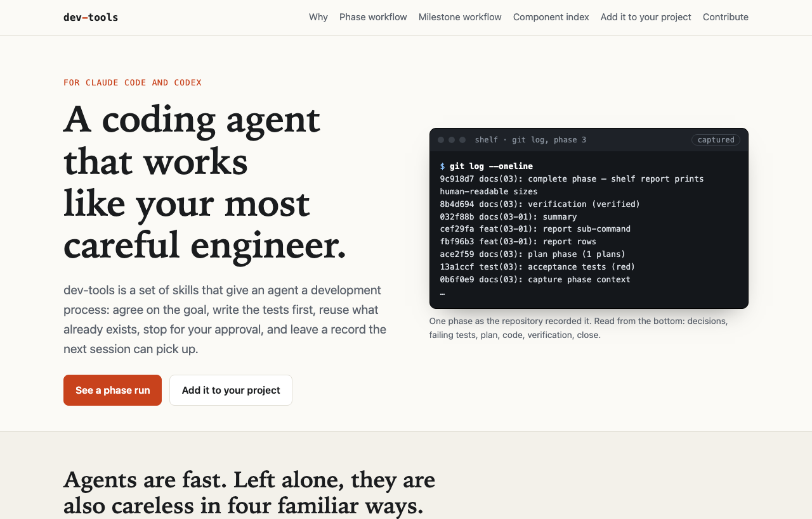

# dev-tools

A development process for coding agents (Claude Code and Codex), kept in one place and
copied into each project that uses it.

**Documentation: <https://vasiloglou.github.io/dev-tools/>**



Status: prototype.

## Why

A coding agent writes code faster than anyone can read it. What is left to settle is
whether the code does what was asked, whether it rebuilt something that already existed,
and whether the next session can carry on from it. These skills make an agent agree on
the goal, write the tests first, reuse what exists, stop for your approval and leave a
record, and each of those is held by a check that can refuse, not by a sentence in a
prompt. The reasoning is on the site:
[Why it exists](https://vasiloglou.github.io/dev-tools/why.html).

## What it gives an agent

- **Phase workflow.** One roadmap phase at a time, in seven steps: Orient, Discuss (with
  a timeboxed prototype), Specify (acceptance tests, locked before code is written),
  Plan, Implement, Verify, Close. You approve at four of them. Two advisory checks
  compare the plans with the agreed tests and the change with the plans.
- **Milestone workflow.** A reviewed plan, a spec you approve before any code, an
  independent review of each change, and numbered records that are never edited.
- **Component index.** A searchable map of what the code already does, so existing code
  is reused instead of written again. The agent can build it for a codebase that has
  none, check it against every change, and review it from the top: repair the index and
  list the code changes it would suggest.
- **Project rules (optional, a trial).** A project states which areas of its code may
  use which, and other rules about its components, and every change is checked against
  them: only what the change added is reported. The index is exported as plain facts;
  the rules are judged by [GND](https://github.com/vasiloglou/gnd-public), which the
  project installs separately. GND is what makes a rule a line of data and not another
  hand-written check, and what tells a new finding from one that was already there:
  [Project rules and GND](https://vasiloglou.github.io/dev-tools/rules.html).

A project picks the workflow that fits it. Both use the component index.

## How a project takes it

This repository is the canonical source. A project lists what it wants in a
`.devtools.toml` file, and the sync command copies those skills and scripts into the
project, where they are committed. The project takes no dependency on this repository.

```bash
python3 path/to/dev-tools/devtools/sync.py apply --project .
```

```bash
python3 path/to/dev-tools/devtools/sync.py check --project .
```

- `apply` copies the files and records each one in `.devtools-receipt.json`. It writes
  nothing unless every file can be written: a file the project edited by hand needs
  `--force`, and an existing file it does not manage yet needs `--adopt`.
- `check` compares the managed files with the receipt. It needs only the project.

Rules that belong to one project go in a file that project owns,
`references/project.md` beside the synced skill. The sync never touches it.

A project that already has its own copies of these skills moves to the shared ones with
the `adopt-devtools` skill (`skills/adopt-devtools/SKILL.md`, read from this checkout). Two
commands that write nothing do the looking:

```bash
python3 path/to/dev-tools/devtools/sync.py survey --project .
```

```bash
python3 path/to/dev-tools/devtools/sync.py compare --project .
```

- `survey` finds the project's copies of what is shipped here, including copies under
  another name, and `survey --toml` prints a starter `.devtools.toml` that keeps the
  project's paths.
- `compare` lists every file an apply would replace and how many of the project's lines
  are in no shipped file; `compare <path>` prints those lines. The skill decides what
  happens to each one before anything is overwritten.

A project that was planned with GSD moves to the phase workflow with the `move-from-gsd`
skill (`skills/move-from-gsd/SKILL.md`, read from this checkout). Both keep the plan in
`.planning/` and name phase folders the same way, so the folder of a finished phase stays
as it is; the roadmap, the requirements and the state are rewritten in the format the
phase tool reads, and GSD's own files are kept in `.planning/archive/gsd/`:

```bash
python3 path/to/dev-tools/devtools/from_gsd.py survey --project .
```

```bash
python3 path/to/dev-tools/devtools/from_gsd.py convert --project . --dry-run
```

- `survey` writes nothing. It lists the plans GSD keeps (the root plan and any
  workstreams), every phase with the status it will get, the requirements, the decisions,
  GSD's install inside the project, and what needs a decision first: which plan to move,
  a phase GSD did not finish, phases it had put off, a roadmap that restarted its numbers.
- `convert` writes the planning files and a record of every choice it made. Phase numbers
  are kept, and a requirement keeps its id with `REQ-` in front (`AUTH-01` becomes
  `REQ-AUTH-01`). A phase GSD did not finish is taken up again from its discussion, with
  GSD's plans for it kept as input in a `gsd/` folder inside the phase folder. Phases GSD
  had paused or left in its backlog are listed, not queued.

Only GSD has a converter. `sync.py survey` names a plan kept by another planning tool (Spec Kit,
OpenSpec, Kiro, BMAD, Task Master, Agent OS, or a `.planning/` folder in another format), and
`skills/adopt-devtools/SKILL.md`, "Coming from another planning tool", says how it is carried
by hand.

See `examples/phase-project.devtools.toml` for a complete project file, and
`examples/components-check.yml` for a GitHub Actions job that checks the index on every
pull request (`examples/rules-check.yml` does the same for a project's own rules). A new project follows
the first sync with `python3 .claude/skills/process-phase/scripts/phase_tool.py setup`.

The sync command, the GSD converter and the component index need Python 3.11 or newer; the phase state tool
runs on 3.9.

## What is here

| Path | What |
|---|---|
| `skills/phase/process-phase/` | The phase workflow. `scripts/phase_tool.py` owns the status transitions and checks, and `phase_tool.py setup` writes a new project's starter planning files. `scripts/coder_pool.py show` prints which coding assistants Implement may run in parallel and how many at once, from a team file and each developer's own. |
| `skills/phase/phase-tests/` | How a phase's acceptance tests are written and locked. |
| `skills/phase/pytest/phase_selection.py` | A pytest plugin: `pytest --phase NN` runs one phase's acceptance tests, and plain `pytest` leaves out phases that are not complete. |
| `agents/` | Helper agents the phase steps hand work to (test writer, researcher, implementer, verifier, code reviewer). |
| `skills/milestone/` | The milestone workflow: `start-milestone`, `process-milestone`, `process-phase`. |
| `skills/components/` | The component index: the skill (consult, update, build, review) and `scripts/components_index.py`, which generates, checks and searches it, drafts entries for unclaimed files, checks a change before a PR, lists leads for a review, and writes the index as facts. `scripts/rules_check.py` is optional and a trial: it checks a project's own rules about its components (layers, and rules it writes) with GND, and reports only what a change added. |
| `skills/adopt-devtools/` | How an agent moves an existing project from its own process skills to these, without losing the project's rules. Read from this checkout; never copied into a project. |
| `skills/move-from-gsd/` | How an agent moves a project planned with GSD to the phase workflow, keeping its phases, requirements, decisions and history. Read from this checkout; never copied into a project. |
| `devtools/sync.py` | The sync command: `apply`, `check`, and for an existing project `survey` and `compare`. |
| `devtools/from_gsd.py` | Reads a GSD planning folder (`survey`) and rewrites it in the phase workflow's format (`convert`). |
| `docs/` | The documentation site (plain HTML, served by GitHub Pages). |
| `tests/` | Tests for the sync command, the GSD converter and the scripts a project runs after a sync. |

## Tests

```bash
uv run --no-project --with pytest python -m pytest tests -q
```

## Contributing

Contributions come in as pull requests from a fork. `main` takes changes only through a
pull request, and the maintainer reviews and merges each one. See
[CONTRIBUTING.md](CONTRIBUTING.md).
